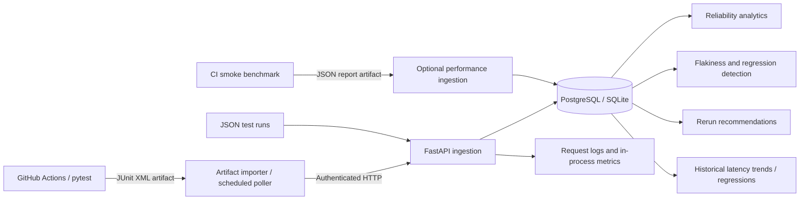

# TestPilot

**Automated CI test intelligence and performance regression detection**

TestPilot is a backend-first platform that ingests pytest/JUnit results, tracks test reliability across commits, detects regressions and flaky outcomes, and recommends which tests to rerun. It also records API latency measurements and compares p95 performance across builds.

**Python · FastAPI · SQLAlchemy · Alembic · PostgreSQL/SQLite · pytest · GitHub Actions**

## Architecture



The benchmark artifact is **not automatically imported** into the database. Publishing latency samples requires calling `POST /performance/samples`. The scheduled JUnit importer requires a reachable backend and configured repository secrets.

## What it does

| Capability | Implementation |
|---|---|
| CI test ingestion | JSON and JUnit XML REST endpoints; GitHub Actions artifact importer |
| Reliable imports | Persistent deduplication by GitHub repository and workflow-run ID |
| Test history | Failure rates, execution duration, pass/fail transitions, branch trends |
| Flaky-test analysis | Conflicting outcomes on the **same commit**; avoids equating every code change with flakiness |
| Regression detection | Pass-to-fail changes, including branch-scoped comparisons |
| Failure clustering | Normalized error-message signatures |
| Test prioritization | Explainable heuristic for recommended reruns |
| Performance monitoring | Request IDs, JSON logs, slow-request warnings, rolling latency statistics |
| Historical latency | Commit-associated p95 measurements and configurable slowdown detection |
| CI benchmarking | Local in-process health endpoint benchmark, uploaded as a JSON artifact |
| Deployment | Alembic migrations, Render Blueprint, optional API-key protection |

## Run locally

Requires Python 3.12+.

```bash
python -m venv .venv
source .venv/bin/activate    # Windows PowerShell: .venv\Scripts\Activate.ps1
pip install -r requirements.txt
alembic upgrade head
uvicorn app.main:app --reload
```

Visit [http://127.0.0.1:8000/docs](http://127.0.0.1:8000/docs) for interactive API documentation.

```bash
# Separate terminal: ingest a test run
curl -X POST http://127.0.0.1:8000/runs \
  -H "Content-Type: application/json" \
  -d '{"commit_sha":"demo123","branch":"main","results":[{"test_name":"tests/test_login.py::test_login","passed":false,"duration_ms":12.5,"error_message":"AssertionError"}]}'

# Inspect analytics
curl http://127.0.0.1:8000/analytics/summary
```

If `TESTPILOT_API_KEY` is set, supply `-H "X-API-Key: YOUR_KEY"` on protected requests.

## Demo walkthrough

The integration test provides a deterministic demo of the complete pipeline without requiring external services:

```bash
python -m pytest -q tests/test_integration_e2e.py
python -m scripts.validate_deployment
python -m scripts.benchmark_api
```

For a guided demonstration, show these endpoints in `/docs`:

1. `POST /runs/junit` — import a JUnit report with a commit SHA.
2. `GET /analytics/tests` and `GET /analytics/regressions` — explain test history and regressions.
3. `GET /analytics/flakiness` — compare repeated executions on the same commit.
4. `GET /recommendations/rerun` — inspect test prioritization.
5. `POST /performance/samples` followed by `GET /performance/regressions` — compare p95 measurements.
6. `GET /metrics` — inspect in-process request statistics.

To create a real JUnit report, run `python -m pytest --junitxml=report.xml` and upload it to `POST /runs/junit` as multipart form data with `commit_sha` and `file` fields.

## CI integration

The **Backend CI** workflow runs tests on pushes and pull requests, uploads `testpilot-junit`, and runs a 100-request local benchmark after tests pass, uploading `testpilot-performance`. Both artifacts are retained for 14 days.

For manual ingestion, set `GITHUB_TOKEN` with Actions read permission, then run:

```bash
python -m scripts.import_github_artifact --repo RianaMalhotra/TestPilot --run-id YOUR_RUN_ID
```

The `Import CI Reports` workflow can poll every six hours. To activate it, configure repository variable `TESTPILOT_API_URL` with your **deployed HTTPS backend** and secret `TESTPILOT_API_KEY` matching the backend. Until configured, scheduled ingestion cannot reach a server. The poller skips workflows other than `Backend CI`; persistent database deduplication prevents duplicate imports.

## Deployment and security

`render.yaml` describes a Render Python web service and managed PostgreSQL database. It runs `alembic upgrade head` before startup and checks `GET /ready`. **No production deployment has been created or verified by this repository.** Review hosting costs before applying the Blueprint.

Set `TESTPILOT_REQUIRE_AUTH=1` and a strong `TESTPILOT_API_KEY` in production. The key protects ingestion, analytics, run details, performance endpoints, and metrics. `/health` and `/ready` are public. `TESTPILOT_REQUIRE_MIGRATIONS=1` enforces the expected Alembic revision in readiness checks. `TESTPILOT_SLOW_REQUEST_MS` sets the slow-request logging threshold (default 1000 ms).

SQLite is suitable for local development; PostgreSQL is intended for persistent hosting. The API uses `create_all` for development convenience; run Alembic migrations before production startup. If upgrading an existing unversioned SQLite database, back it up and reconcile its schema before stamping or migrating.

## Technical notes and limitations

- Same-commit inconsistency is evidence of flakiness, not proof of the underlying cause.
- Failure clustering uses normalized first-line error signatures, not semantic embeddings.
- Latency regression comparisons use the preceding recorded sample for each branch/method/route when the commit changes; they do not account for statistical variance or machine differences.
- The CI benchmark measures an **in-process test client**, not deployed network performance. CI runner contention can change measurements.
- `GET /metrics` uses process-local counters and the latest 500 latency samples per route; statistics reset on restart and are not aggregated across workers.
- GitHub artifact polling uses local state for efficiency and persistent database deduplication for correctness. The state file is not shared between CI runners.
- There is no deployed UI; this is intentionally a backend/API project.

## Validation

```bash
python -m pytest -q
python -m scripts.validate_deployment
```

GitHub Actions provides the current CI result in the [Actions tab](https://github.com/RianaMalhotra/TestPilot/actions).

## Resume-ready description

**TestPilot — CI Test Intelligence & Regression Analytics | Python, FastAPI, PostgreSQL, pytest, GitHub Actions**

Built a backend platform to ingest and deduplicate CI/JUnit test reports, analyze historical test failures and same-commit flakiness, detect functional and API latency regressions, and prioritize reruns. Implemented authenticated REST APIs, Alembic migrations, structured observability, GitHub Actions artifact ingestion, and automated integration/benchmark tests.
