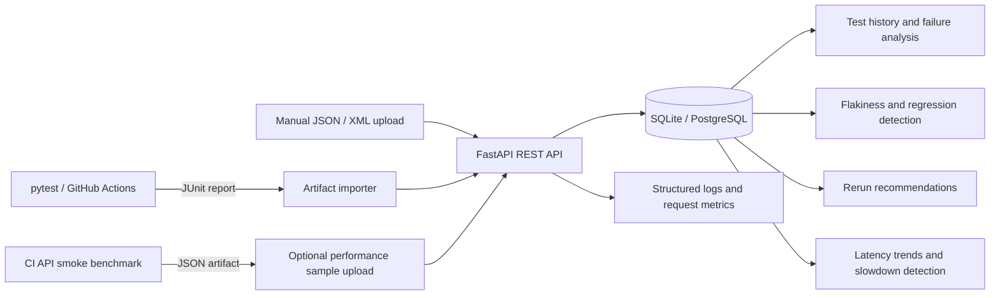
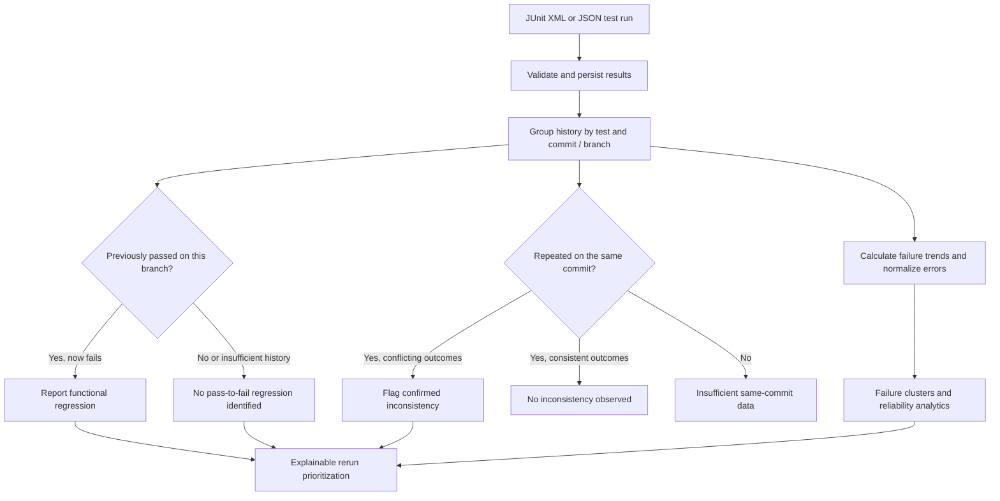

# TestPilot

**Automated CI test intelligence and performance regression detection**

TestPilot is a backend-first platform that ingests pytest/JUnit results, tracks test reliability across commits, detects regressions and flaky outcomes, and recommends which tests to rerun. It also records API latency measurements and compares p95 performance across builds.

**Python · FastAPI · SQLAlchemy · Alembic · PostgreSQL/SQLite · pytest · GitHub Actions**

## At a glance

| | |
|---|---|
| **Problem** | CI reports show failures but rarely explain which ones are new, recurring, or inconsistent. |
| **Solution** | A REST API that stores test history, detects regressions and same-commit flakiness, clusters failures, and ranks reruns. |
| **Engineering focus** | Backend API design, SQL data modeling, test automation, CI integration, and explainable heuristics. |
| **Try it** | Run `python -m scripts.demo` for an isolated, reproducible example. |
| **Verification** | [GitHub Actions CI](https://github.com/RianaMalhotra/TestPilot/actions) · [Automated tests](https://github.com/RianaMalhotra/TestPilot/tree/main/tests) |
| **Deployment** | GitHub-only portfolio project; no hosted API required. |

## Why I built it

CI pipelines can tell you **that a test failed**, but they don't always explain whether the failure is new, recurring, or inconsistent. When a suite grows, manually comparing reports across commits and deciding which tests to rerun becomes time-consuming.

I built TestPilot to turn individual CI test reports into a searchable history of software reliability. The goal is to help developers answer three practical questions: **What broke? Has it happened before? What should I investigate or rerun first?**

## What it does

TestPilot is a backend API for analyzing automated test results and spotting changes in software quality over time.

- **Tracks test reliability:** Records pass/fail results, execution times, failure rates, and trends across commits and branches.
- **Detects functional regressions:** Identifies tests that previously passed but now fail.
- **Investigates flaky tests:** Looks for inconsistent outcomes when the same test is executed repeatedly on the **same commit**.
- **Groups recurring failures:** Clusters failures using normalized error-message signatures to make repeated issues easier to recognize.
- **Recommends reruns:** Ranks tests using an explainable heuristic so developers can focus on the most useful next checks.
- **Monitors API performance:** Records p95 latency by commit and flags slowdowns relative to previous measurements.
- **Supports CI workflows:** Imports JUnit XML reports from GitHub Actions and produces local API benchmark artifacts.

TestPilot is intentionally **backend-first**: its outputs are available through REST endpoints and interactive FastAPI documentation rather than a custom dashboard.

## How it works

1. **Collect:** pytest generates a JUnit XML report in GitHub Actions. An importer can retrieve the artifact and send it to TestPilot, or a developer can submit JUnit XML or JSON directly.
2. **Store:** FastAPI validates the incoming data, then SQLAlchemy persists runs, individual test outcomes, commit/branch metadata, and performance samples in SQLite or PostgreSQL. GitHub imports are deduplicated using repository and workflow-run identifiers.
3. **Analyze:** API endpoints compare historical outcomes to calculate failure trends, identify pass-to-fail regressions, classify same-commit inconsistency, and group similar error messages.
4. **Prioritize:** A transparent rerun recommendation heuristic surfaces tests worth investigating. Performance endpoints compare recorded p95 latency samples across commits.
5. **Observe:** Structured request logs, request IDs, slow-request warnings, and process-local metrics help diagnose API behavior.

### System architecture



### Test analysis pipeline

This diagram shows how TestPilot turns recorded test outcomes into actionable analysis. The branches represent **separate analyses**, not a single decision tree: a failed test is not automatically classified as flaky.



**How to read it:** Regression detection compares outcomes over time, while flakiness detection specifically looks for conflicting results on the *same commit*. Failure clusters and reliability trends provide additional context for investigating failures. Rerun recommendations use the platform's heuristic; they are not a machine-learning prediction.

**Tech stack:** Python, FastAPI, Pydantic, SQLAlchemy, Alembic, PostgreSQL/SQLite, pytest, httpx, GitHub Actions, and Render deployment configuration.

**Important distinction:** GitHub Actions produces the performance benchmark report, but it is not automatically imported into the historical performance database. The scheduled JUnit importer also requires a deployed, reachable API and configured credentials.

## Example: from a failed test to an actionable result

Consider a checkout test that passes on one commit and fails after a change. TestPilot stores both runs and compares their history.

| Commit | Test | Outcome | Duration |
|---|---|---|---|
| `a1b2c3` | `tests/test_checkout.py::test_payment` | Passed | 12 ms |
| `d4e5f6` | `tests/test_checkout.py::test_payment` | Failed | 15 ms |

**1. Submit both results** using `POST /runs`:

```bash
curl -X POST http://127.0.0.1:8000/runs \
  -H "Content-Type: application/json" \
  -d '{"commit_sha":"a1b2c3","branch":"main","results":[{"test_name":"tests/test_checkout.py::test_payment","passed":true,"duration_ms":12}]}'

curl -X POST http://127.0.0.1:8000/runs \
  -H "Content-Type: application/json" \
  -d '{"commit_sha":"d4e5f6","branch":"main","results":[{"test_name":"tests/test_checkout.py::test_payment","passed":false,"duration_ms":15,"error_message":"AssertionError"}]}'
```

**2. Ask TestPilot what changed:**

```bash
curl http://127.0.0.1:8000/analytics/branch-regressions?branch=main
curl http://127.0.0.1:8000/recommendations/rerun
```

**3. Interpret the result:**

- **Regression:** The checkout test changed from passing to failing on the same branch, so it is flagged for investigation.
- **Rerun priority:** With two executions, one failure, and one status transition, the heuristic computes a priority score of `0.5 × 70 + 1 × 10 = 45`. This score is for *ranking*, not a probability of failure.
- **Flakiness:** This example **does not establish flakiness**. To identify inconsistent outcomes, the same test must be rerun on the same commit.

This is an **illustrative example**, not a benchmark result or screenshot from a deployed service. If API-key authentication is enabled, include the `X-API-Key` header in each request. Use a fresh local database to reproduce the example without unrelated history.

## One-command demo

Run a complete example **without deploying a server or touching your existing database**:

```bash
python -m scripts.demo
```

The script creates a temporary SQLite database, ingests a passing and failing checkout test on consecutive commits, then prints the branch regression, rerun recommendation, and same-commit flakiness classification responses. It deletes the temporary database when finished. This is a local, reproducible API demonstration, not a live production deployment.

## Run locally

Requires Python 3.12+.

```bash
python -m venv .venv
source .venv/bin/activate    # Windows PowerShell: .venv\Scripts\Activate.ps1
pip install -r requirements.txt
alembic upgrade head
uvicorn app.main:app --reload
```

Visit [http://127.0.0.1:8000/docs](http://127.0.0.1:8000/docs) for interactive API documentation.

```bash
# Separate terminal: ingest a test run
curl -X POST http://127.0.0.1:8000/runs \
  -H "Content-Type: application/json" \
  -d '{"commit_sha":"demo123","branch":"main","results":[{"test_name":"tests/test_login.py::test_login","passed":false,"duration_ms":12.5,"error_message":"AssertionError"}]}'

# Inspect analytics
curl http://127.0.0.1:8000/analytics/summary
```

If `TESTPILOT_API_KEY` is set, supply `-H "X-API-Key: YOUR_KEY"` on protected requests.

## Demo walkthrough

The integration test provides a deterministic demo of the complete pipeline without requiring external services:

```bash
python -m pytest -q tests/test_integration_e2e.py
python -m scripts.validate_deployment
python -m scripts.benchmark_api
```

For a guided demonstration, show these endpoints in `/docs`:

1. `POST /runs/junit` — import a JUnit report with a commit SHA.
2. `GET /analytics/tests` and `GET /analytics/regressions` — explain test history and regressions.
3. `GET /analytics/flakiness` — compare repeated executions on the same commit.
4. `GET /recommendations/rerun` — inspect test prioritization.
5. `POST /performance/samples` followed by `GET /performance/regressions` — compare p95 measurements.
6. `GET /metrics` — inspect in-process request statistics.

To create a real JUnit report, run `python -m pytest --junitxml=report.xml` and upload it to `POST /runs/junit` as multipart form data with `commit_sha` and `file` fields.

## CI integration

The **Backend CI** workflow runs tests on pushes and pull requests, uploads `testpilot-junit`, and runs a 100-request local benchmark after tests pass, uploading `testpilot-performance`. Both artifacts are retained for 14 days.

For manual ingestion, set `GITHUB_TOKEN` with Actions read permission, then run:

```bash
python -m scripts.import_github_artifact --repo RianaMalhotra/TestPilot --run-id YOUR_RUN_ID
```

The `Import CI Reports` workflow can poll every six hours. To activate it, configure repository variable `TESTPILOT_API_URL` with your **deployed HTTPS backend** and secret `TESTPILOT_API_KEY` matching the backend. Until configured, scheduled ingestion cannot reach a server. The poller skips workflows other than `Backend CI`; persistent database deduplication prevents duplicate imports.

## Deployment and security

`render.yaml` describes a Render Python web service and managed PostgreSQL database. It runs `alembic upgrade head` before startup and checks `GET /ready`. **No production deployment has been created or verified by this repository.** Review hosting costs before applying the Blueprint.

Set `TESTPILOT_REQUIRE_AUTH=1` and a strong `TESTPILOT_API_KEY` in production. The key protects ingestion, analytics, run details, performance endpoints, and metrics. `/health` and `/ready` are public. `TESTPILOT_REQUIRE_MIGRATIONS=1` enforces the expected Alembic revision in readiness checks. `TESTPILOT_SLOW_REQUEST_MS` sets the slow-request logging threshold (default 1000 ms).

SQLite is suitable for local development; PostgreSQL is intended for persistent hosting. The API uses `create_all` for development convenience; run Alembic migrations before production startup. If upgrading an existing unversioned SQLite database, back it up and reconcile its schema before stamping or migrating.

## Technical notes and limitations

- Same-commit inconsistency is evidence of flakiness, not proof of the underlying cause.
- Failure clustering uses normalized first-line error signatures, not semantic embeddings.
- Latency regression comparisons use the preceding recorded sample for each branch/method/route when the commit changes; they do not account for statistical variance or machine differences.
- The CI benchmark measures an **in-process test client**, not deployed network performance. CI runner contention can change measurements.
- `GET /metrics` uses process-local counters and the latest 500 latency samples per route; statistics reset on restart and are not aggregated across workers.
- GitHub artifact polling uses local state for efficiency and persistent database deduplication for correctness. The state file is not shared between CI runners.
- There is no deployed UI; this is intentionally a backend/API project.

## Validation

```bash
python -m pytest -q
python -m scripts.validate_deployment
```

GitHub Actions provides the current CI result in the [Actions tab](https://github.com/RianaMalhotra/TestPilot/actions).

**TestPilot — CI Test Intelligence & Regression Analytics | Python, FastAPI, PostgreSQL, pytest, GitHub Actions**

Built a backend platform to ingest and deduplicate CI/JUnit test reports, analyze historical test failures and same-commit flakiness, detect functional and API latency regressions, and prioritize reruns. Implemented authenticated REST APIs, Alembic migrations, structured observability, GitHub Actions artifact ingestion, and automated integration/benchmark tests.
